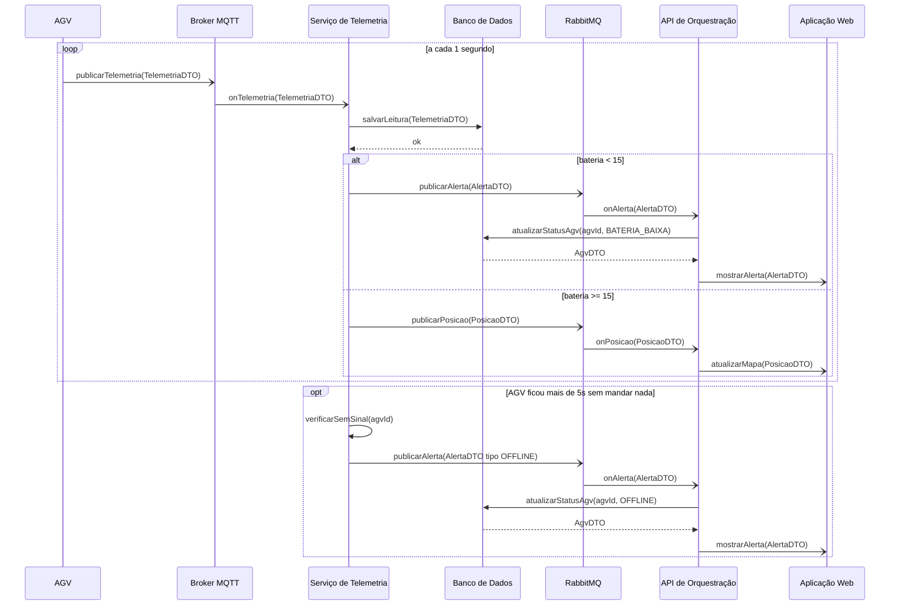
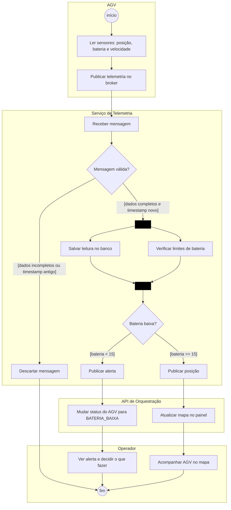
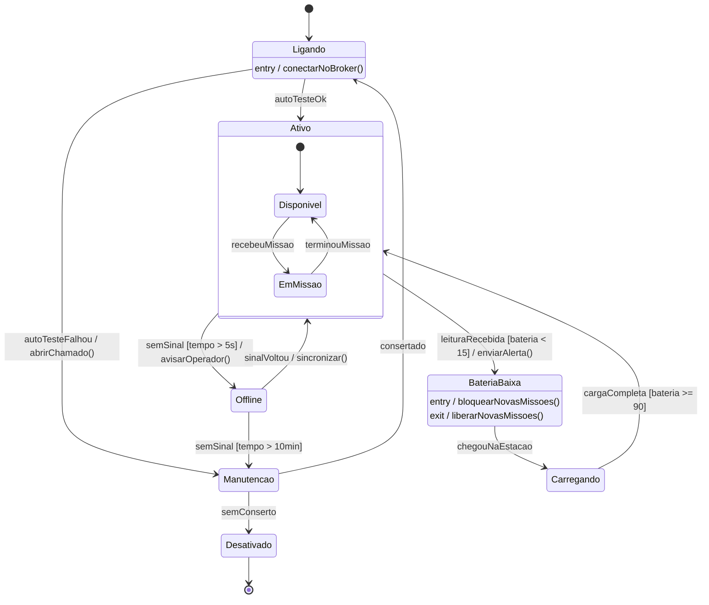
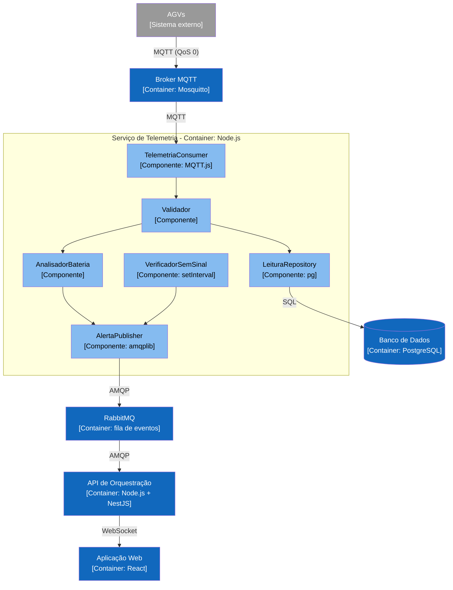

# APS 3 - Telemetria e Alertas dos AGVs

Aluno: **Carlos Tokarski Borges Neto**
Modelagem de Software - Prof. Sidney L. da Silva
Projeto: Sistema de Logística de Entregas Autônomas (AGVs)

## Funcionalidade escolhida

Minha parte é a **telemetria dos AGVs**, ou seja, como o sistema recebe os dados que os veículos mandam e o que faz com eles.

Funciona assim:
1. o AGV manda posição, bateria e velocidade a cada 1 segundo pelo broker MQTT;
2. o Serviço de Telemetria recebe, confere se a mensagem está certa e, ao mesmo tempo, salva no banco e verifica a bateria;
3. se a bateria estiver abaixo de 15%, sai um alerta e o AGV fica como `BATERIA_BAIXA` (ele para de receber missões);
4. se estiver tudo normal, só atualiza a posição no mapa do operador;
5. se o AGV ficar mais de 5 segundos sem mandar nada, ele é marcado como `OFFLINE`.

Essa parte é importante porque o despacho e o replanejamento de rotas dependem de saber onde cada AGV está e quanta bateria ele tem.

## Operações de cada participante

| Participante | Operações |
|---|---|
| Broker MQTT | `publicarTelemetria(TelemetriaDTO)` |
| Serviço de Telemetria | `onTelemetria(TelemetriaDTO)`, `verificarSemSinal(agvId)` |
| Banco de Dados | `salvarLeitura(TelemetriaDTO)`, `atualizarStatusAgv(agvId, status)` |
| RabbitMQ | `publicarAlerta(AlertaDTO)`, `publicarPosicao(PosicaoDTO)` |
| API de Orquestração | `onAlerta(AlertaDTO)`, `onPosicao(PosicaoDTO)` |
| Aplicação Web | `mostrarAlerta(AlertaDTO)`, `atualizarMapa(PosicaoDTO)` |

## Artefato 1 - Diagrama de Sequência

Setas: `->>` síncrona, `-)` assíncrona (MQTT, RabbitMQ e WebSocket), `-->>` retorno.

## Artefato 2 - Diagrama de Atividades

O fork divide em duas tarefas que rodam em paralelo (salvar a leitura e verificar a bateria) e o join espera as duas terminarem.

## Artefato 3 - Diagrama de Estados do AGV

Para o AGV não ficar trocando de estado o tempo todo perto dos 15%, ele só volta a ficar `Ativo` depois de carregar até 90%. E leituras com timestamp mais antigo que a última são descartadas, para uma mensagem atrasada não "desfazer" um alerta.

## Artefato 4 - C4 Nível 3

## Artefato 5 - ADR

[ADR 0001 - Usar MQTT para receber a telemetria dos AGVs](docs/architecture/adr-0001.md)

## Como os diagramas se conectam

- O **fork/join** das atividades (salvar leitura + verificar bateria) aparece na sequência como `salvarLeitura()` seguido do `alt` da bateria.
- O alerta de bateria (`publicarAlerta` → `onAlerta` → `atualizarStatusAgv(BATERIA_BAIXA)`) é a transição `Ativo → BateriaBaixa` da máquina de estados.
- O `opt` de 5 segundos sem sinal é a transição `Ativo → Offline`.
